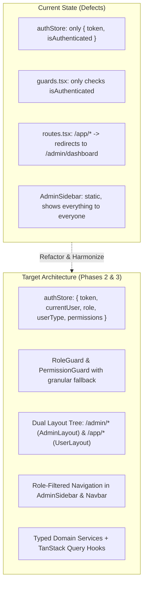
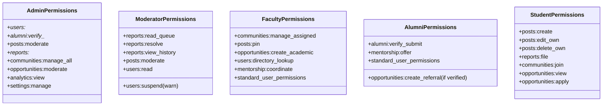
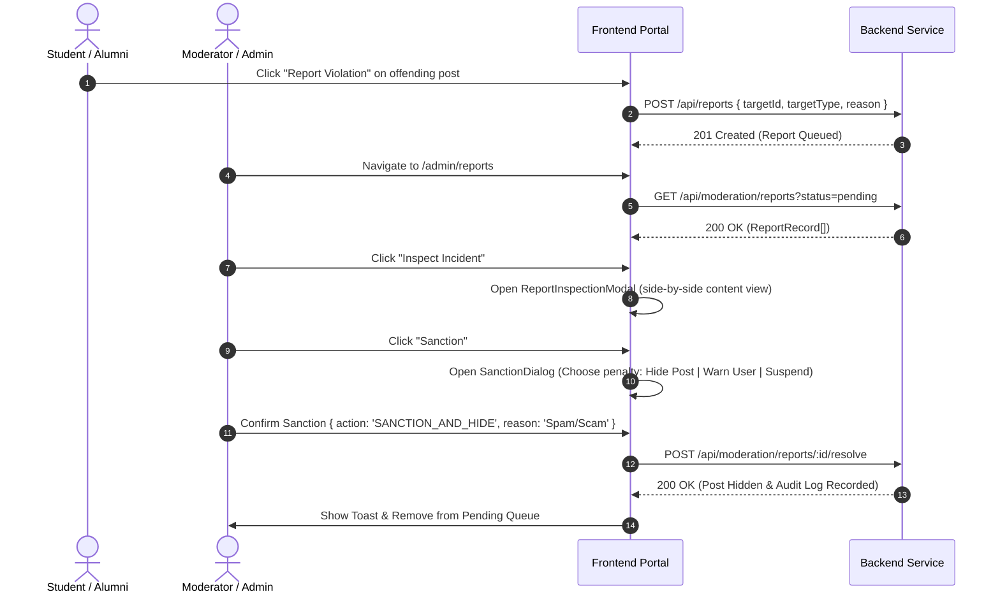
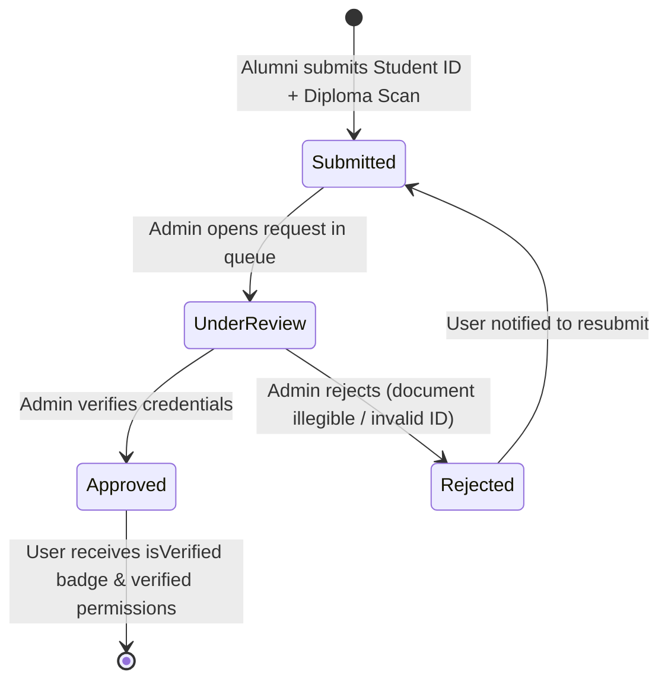
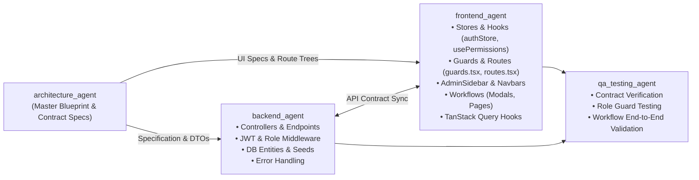
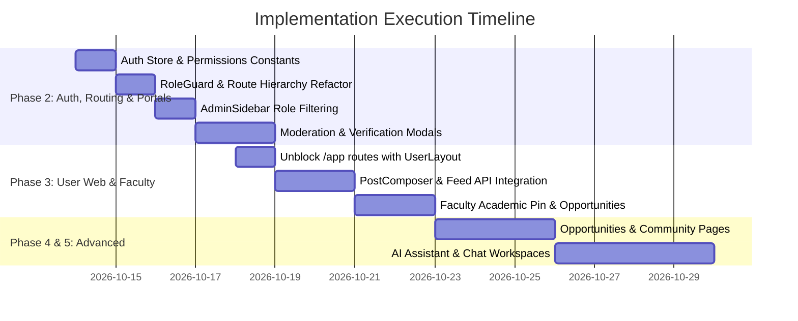

# FPT University Alumni Community Platform
# Architecture Specification & Implementation Plan (Phases 2 & 3)

**Document Status:** Approved Architecture Plan  
**Target Architecture:** Modular Monolith Frontend (Vite + React 19 + TypeScript + Zustand + TanStack Query) & RESTful Backend Service  
**Target Audience:** `architecture_agent`, `frontend_agent`, `backend_agent`, `qa_testing_agent`  
**Referenced Baseline Documents:**
- [`docs/role-requirements-matrix.md`](file:///d:/KI%208/PRN232/ASM/docs/role-requirements-matrix.md)
- [`AGENTS.md`](file:///d:/KI%208/PRN232/ASM/AGENTS.md)
- [`DESIGN.md`](file:///d:/KI%208/PRN232/ASM/DESIGN.md)
- Current Codebase: [`src/app/router/routes.tsx`](file:///d:/KI%208/PRN232/ASM/src/app/router/routes.tsx), [`src/stores/authStore.ts`](file:///d:/KI%208/PRN232/ASM/src/stores/authStore.ts), [`src/constants/roles.ts`](file:///d:/KI%208/PRN232/ASM/src/constants/roles.ts), [`src/constants/userTypes.ts`](file:///d:/KI%208/PRN232/ASM/src/constants/userTypes.ts), [`src/components/layout/AdminSidebar.tsx`](file:///d:/KI%208/PRN232/ASM/src/components/layout/AdminSidebar.tsx)

---

## 1. Executive Summary & Architectural Overview

The **FPT Alumni Community Platform** is designed to serve a dual mandate across 5 national campuses (Hoa Lac - Hanoi, Da Nang, Ho Chi Minh City, Can Tho, and Quy Nhon):
1. **Administrative & Governance Operations:** Multi-tier portal for System Administrators and Community Safety Moderators to govern user lifecycles, audit alumni degree credentials, handle content takedowns, and monitor analytics.
2. **Academic & Community Engagement:** Rich desktop social and career ecosystem enabling Faculty Coordinators to post academic notices, verified alumni to share career referrals and mentorship sessions, and students to participate in academic Q&A, find opportunities, and engage with the university network.

### 1.1 Architectural Challenges Identified in Current State
1. **Absence of Role-Aware State:** [`src/stores/authStore.ts`](file:///d:/KI%208/PRN232/ASM/src/stores/authStore.ts) only retains `{ token: string | null, isAuthenticated: boolean }`. It contains no information regarding the user identity, role, or userType.
2. **Coarse-Grained Routing Guards:** [`src/app/router/guards.tsx`](file:///d:/KI%208/PRN232/ASM/src/app/router/guards.tsx) solely checks `isAuthenticated`. Any authenticated user can access any route, regardless of whether they are an Admin, Moderator, Faculty member, or Student.
3. **End-User Route Black Hole:** In [`src/app/router/routes.tsx`](file:///d:/KI%208/PRN232/ASM/src/app/router/routes.tsx#L124-L126), the entire `/app/*` path redirects to `/admin/dashboard`. This blocks students, alumni, and faculty from accessing the web community feed (`UserLayout` + `HomePage`).
4. **Unified Admin Sidebar Leaking Administrative Controls:** [`src/components/layout/AdminSidebar.tsx`](file:///d:/KI%208/PRN232/ASM/src/components/layout/AdminSidebar.tsx) exposes all modules (Users, Settings, Verification, Analytics) statically to any visitor of the `/admin` area.
5. **Decoupled API Skeleton:** The domain services under `src/services/*` export empty objects (`{}`), forcing pages to rely on component-level mock data and violating the TanStack Query architecture defined in [`AGENTS.md`](file:///d:/KI%208/PRN232/ASM/AGENTS.md).



---

## 2. Role & Permission System Architecture

### 2.1 Actor Taxonomy & The Dual-Axis Model
The system uses a **Dual-Axis Model** combining a technical `Role` with a university `UserType`. This provides both high-level security containment and domain-specific persona identification.

```
                    ┌──────────────────────────────────────────────┐
                    │               Platform Actor                 │
                    └──────────────────────┬───────────────────────┘
                                           │
                 ┌─────────────────────────┴─────────────────────────┐
                 ▼                                                   ▼
       Axis 1: System Security Role                      Axis 2: University Persona
         (Governs Portal Access)                          (Governs Community Domain)
       • ROLES.ADMIN                                     • USER_TYPES.FACULTY
       • ROLES.MODERATOR                                 • USER_TYPES.ALUMNI
       • ROLES.USER                                      • USER_TYPES.STUDENT
```

#### Dual-Axis Harmonization Matrix

| Actor Category | System Role (`user.role`) | University Persona (`user.userType`) | Effective Persona (`effectiveRole`) | System Authority Tier |
| :--- | :--- | :--- | :--- | :--- |
| **System Admin** | `ROLES.ADMIN` | `USER_TYPES.FACULTY` or `STAFF` | `'ADMIN'` | **Tier 4 (Superuser)** |
| **Safety Moderator** | `ROLES.MODERATOR` | `USER_TYPES.FACULTY` or `ALUMNI` | `'MODERATOR'` | **Tier 3 (Safety Governance)** |
| **Faculty / Staff** | `ROLES.USER` | `USER_TYPES.FACULTY` | `'FACULTY'` | **Tier 2 (Academic Coordinator)** |
| **Verified Alumni** | `ROLES.USER` | `USER_TYPES.ALUMNI` (`isVerified: true`) | `'ALUMNI'` | **Tier 1 (Verified Peer)** |
| **Unverified Alumni** | `ROLES.USER` | `USER_TYPES.ALUMNI` (`isVerified: false`)| `'ALUMNI'` (Pending) | **Tier 1 (Restricted Peer)** |
| **Enrolled Student** | `ROLES.USER` | `USER_TYPES.STUDENT` | `'STUDENT'` | **Tier 1 (Learner)** |

> [!NOTE]
> Backward & Forward Compatibility: To avoid hard forks, the helper `hasRole(user, allowedRoles)` evaluates both `user.role` and `user.userType`. If a route specifies `allowedRoles: ['FACULTY']`, it evaluates `user.role === 'FACULTY' || (user.role === 'USER' && user.userType === 'FACULTY')`.

---

### 2.2 Granular Permission Capabilities (Master Permission Enum)

To decouple UI action visibility and backend authorization from raw role strings, permissions are defined as capability tokens (`domain:action`):

```ts
// src/constants/permissions.ts
export const PERMISSIONS = {
  // 1. User & Account Management
  USERS_READ: 'users:read',
  USERS_SUSPEND: 'users:suspend',
  USERS_CHANGE_ROLE: 'users:change_role',
  USERS_DIRECTORY_LOOKUP: 'users:directory_lookup',

  // 2. Alumni Verification
  ALUMNI_VERIFY_READ: 'alumni:verify_read',
  ALUMNI_VERIFY_APPROVE: 'alumni:verify_approve',
  ALUMNI_VERIFY_REJECT: 'alumni:verify_reject',
  ALUMNI_VERIFY_SUBMIT: 'alumni:verify_submit',

  // 3. Post & Discussion Management
  POSTS_CREATE: 'posts:create',
  POSTS_EDIT_OWN: 'posts:edit_own',
  POSTS_DELETE_OWN: 'posts:delete_own',
  POSTS_MODERATE: 'posts:moderate', // Hide, suppress, or delete violating posts
  POSTS_PIN: 'posts:pin',           // Pin official announcement in community

  // 4. Moderation & Safety Reports
  REPORTS_READ_QUEUE: 'reports:read_queue',
  REPORTS_RESOLVE: 'reports:resolve',       // Sanction content, warn user, dismiss
  REPORTS_VIEW_HISTORY: 'reports:view_history',
  REPORTS_FILE: 'reports:file',             // Standard user filing report

  // 5. Community Chapter Governance
  COMMUNITIES_CREATE: 'communities:create',
  COMMUNITIES_MANAGE_ALL: 'communities:manage_all',
  COMMUNITIES_MANAGE_ASSIGNED: 'communities:manage_assigned', // Faculty coordinating department
  COMMUNITIES_JOIN: 'communities:join',

  // 6. Opportunities & Career
  OPPORTUNITIES_VIEW: 'opportunities:view',
  OPPORTUNITIES_CREATE_REFERRAL: 'opportunities:create_referral', // Verified alumni
  OPPORTUNITIES_CREATE_ACADEMIC: 'opportunities:create_academic', // Faculty capstones/fellowships
  OPPORTUNITIES_MODERATE: 'opportunities:moderate',               // Admin/mod approve/close
  OPPORTUNITIES_APPLY: 'opportunities:apply',

  // 7. Mentorship Coordination
  MENTORSHIP_COORDINATE: 'mentorship:coordinate', // Faculty scheduling department office hours
  MENTORSHIP_OFFER: 'mentorship:offer',           // Alumni accepting mentees

  // 8. System & Insights
  ANALYTICS_VIEW: 'analytics:view',
  SETTINGS_VIEW: 'settings:view',
  SETTINGS_MANAGE: 'settings:manage',
} as const

export type Permission = (typeof PERMISSIONS)[keyof typeof PERMISSIONS]
```

---

### 2.3 Role-to-Permissions Mapping Matrix



| Permission Token | Admin | Moderator | Faculty | Verified Alumni | Enrolled Student |
| :--- | :---: | :---: | :---: | :---: | :---: |
| `users:read` | ✅ | ✅ (Limited) | ❌ | ❌ | ❌ |
| `users:suspend` | ✅ | ⚠️ (Warn/Flag) | ❌ | ❌ | ❌ |
| `users:directory_lookup` | ✅ | ✅ | ✅ | ✅ | ✅ |
| `alumni:verify_read` | ✅ | ❌ | ❌ | ❌ | ❌ |
| `alumni:verify_approve` / `reject` | ✅ | ❌ | ❌ | ❌ | ❌ |
| `alumni:verify_submit` | ❌ | ❌ | ❌ | ✅ (If unverified)| ❌ |
| `posts:create` | ✅ | ✅ | ✅ | ✅ | ✅ |
| `posts:moderate` | ✅ | ✅ | ❌ | ❌ | ❌ |
| `posts:pin` | ✅ | ❌ | ✅ (Assigned) | ❌ | ❌ |
| `reports:read_queue` | ✅ | ✅ | ❌ | ❌ | ❌ |
| `reports:resolve` | ✅ | ✅ | ❌ | ❌ | ❌ |
| `reports:view_history` | ✅ | ✅ | ❌ | ❌ | ❌ |
| `reports:file` | ✅ | ✅ | ✅ | ✅ | ✅ |
| `communities:create` | ✅ | ❌ | ❌ | ❌ | ❌ |
| `communities:manage_assigned` | ✅ | ❌ | ✅ | ❌ | ❌ |
| `opportunities:create_referral`| ✅ | ❌ | ❌ | ✅ | ❌ |
| `opportunities:create_academic`| ✅ | ❌ | ✅ | ❌ | ❌ |
| `opportunities:moderate` | ✅ | ✅ | ❌ | ❌ | ❌ |
| `analytics:view` | ✅ | ❌ | ❌ | ❌ | ❌ |
| `settings:manage` | ✅ | ❌ | ❌ | ❌ | ❌ |

---

### 2.4 Action Visibility Matrix (Component-Level Buttons & Modals)

| Screen / Component | UI Action / Button | Admin | Moderator | Faculty | Student / Alumni |
| :--- | :--- | :---: | :---: | :---: | :---: |
| `AdminSidebar` | "Users" & "Verification" Links | Visible | Hidden | Hidden | Hidden (Cannot access /admin) |
| `AdminSidebar` | "Reports" Queue Link | Visible | Visible | Hidden | Hidden |
| `AdminSidebar` | "Analytics" & "Settings" Links | Visible | Hidden | Hidden | Hidden |
| `UsersManagementPage` | "Suspend Account" Button | Enabled | Disabled/Warn | N/A | N/A |
| `ReportsManagementPage` | "Take Down Content" & "Sanction" | Enabled | Enabled | N/A | N/A |
| `AlumniVerificationPage`| "Approve" / "Reject" Buttons | Enabled | Hidden | N/A | N/A |
| `PostCard` | "Hide Content" (Context menu) | Visible | Visible | Hidden | Hidden |
| `PostCard` | "Pin to Community" (Context menu) | Visible | Hidden | Visible (In own dept) | Hidden |
| `PostCard` | "Report Violation" (Context menu) | Hidden (Self-admin)| Hidden | Visible | Visible |
| `PostComposer` | "Attach Job Referral" chip | Visible | Hidden | Hidden | Visible (Verified only) |
| `PostComposer` | "Attach Capstone Proposal" chip| Visible | Hidden | Visible | Hidden |

---

## 3. Client State & Authorization Architecture

### 3.1 Upgraded `authStore` Design
Located at [`src/stores/authStore.ts`](file:///d:/KI%208/PRN232/ASM/src/stores/authStore.ts).
The store is upgraded to persist the full user identity, role, userType, campus affiliation, and computed permissions alongside the token.

```ts
// src/types/user.types.ts (Enhanced)
import type { Role } from '@/constants/roles'
import type { UserType } from '@/constants/userTypes'

export type CampusCode = 'HOA_LAC' | 'DA_NANG' | 'HCM' | 'CAN_THO' | 'QUY_NHON'

export interface UserSummary {
  id: string
  name: string
  email: string
  avatarUrl?: string
  role: Role
  userType: UserType
  campus: CampusCode | string
  isVerified: boolean
  department?: string
  studentId?: string
  cohort?: string
}

// src/stores/authStore.ts
import { create } from 'zustand'
import { persist, createJSONStorage } from 'zustand/middleware'
import type { UserSummary } from '@/types/user.types'
import type { Role } from '@/constants/roles'
import type { UserType } from '@/constants/userTypes'
import { getPermissionsForUser } from '@/lib/permissions'

export interface AuthState {
  token: string | null
  currentUser: UserSummary | null
  role: Role | null
  userType: UserType | null
  isAuthenticated: boolean
  permissions: string[]

  // Actions
  setAuth: (payload: { token: string; user: UserSummary }) => void
  updateCurrentUser: (partialUser: Partial<UserSummary>) => void
  clearAuth: () => void
}

export const useAuthStore = create<AuthState>()(
  persist(
    (set, get) => ({
      token: null,
      currentUser: null,
      role: null,
      userType: null,
      isAuthenticated: false,
      permissions: [],

      setAuth: ({ token, user }) => {
        const computedPermissions = getPermissionsForUser(user)
        // Ensure localStorage access_token is synchronized for Axios interceptors
        localStorage.setItem('access_token', token)
        set({
          token,
          currentUser: user,
          role: user.role,
          userType: user.userType,
          isAuthenticated: true,
          permissions: computedPermissions,
        })
      },

      updateCurrentUser: (partialUser) => {
        const existing = get().currentUser
        if (!existing) return
        const updated = { ...existing, ...partialUser }
        set({
          currentUser: updated,
          role: updated.role,
          userType: updated.userType,
          permissions: getPermissionsForUser(updated),
        })
      },

      clearAuth: () => {
        localStorage.removeItem('access_token')
        set({
          token: null,
          currentUser: null,
          role: null,
          userType: null,
          isAuthenticated: false,
          permissions: [],
        })
      },
    }),
    {
      name: 'alumni-auth-storage',
      storage: createJSONStorage(() => localStorage),
    }
  )
)
```

---

### 3.2 Authorization Hooks & Helper Utilities

```ts
// src/hooks/usePermissions.ts
import { useAuthStore } from '@/stores/authStore'
import type { Permission } from '@/constants/permissions'
import type { Role } from '@/constants/roles'
import type { UserType } from '@/constants/userTypes'

export const usePermissions = () => {
  const { currentUser, role, userType, permissions, isAuthenticated } = useAuthStore()

  const hasPermission = (permission: Permission): boolean => {
    if (!isAuthenticated || !currentUser) return false
    if (role === 'ADMIN') return true // Superuser grant
    return permissions.includes(permission)
  }

  const hasAnyPermission = (perms: Permission[]): boolean => {
    return perms.some((p) => hasPermission(p))
  }

  const hasRole = (allowedRoles: (Role | 'FACULTY')[]): boolean => {
    if (!isAuthenticated || !currentUser) return false
    if (role === 'ADMIN') return true // Superuser bypass

    return allowedRoles.some((allowed) => {
      if (allowed === 'FACULTY') {
        return role === 'FACULTY' || (role === 'USER' && userType === 'FACULTY')
      }
      return role === allowed
    })
  }

  const isVerifiedAlumni = (): boolean => {
    return userType === 'ALUMNI' && Boolean(currentUser?.isVerified)
  }

  return {
    currentUser,
    role,
    userType,
    isAuthenticated,
    hasPermission,
    hasAnyPermission,
    hasRole,
    isVerifiedAlumni,
  }
}
```

#### Reusable Action Gate Component (`<Can />`)
```tsx
// src/components/common/Can.tsx
import type { ReactNode, FC } from 'react'
import { usePermissions } from '@/hooks/usePermissions'
import type { Permission } from '@/constants/permissions'
import type { Role } from '@/constants/roles'

interface CanProps {
  do?: Permission | Permission[]
  role?: Role | 'FACULTY' | (Role | 'FACULTY')[]
  children: ReactNode
  fallback?: ReactNode
}

export const Can: FC<CanProps> = ({ do: permission, role, children, fallback = null }) => {
  const { hasPermission, hasAnyPermission, hasRole } = usePermissions()

  if (permission) {
    const isGranted = Array.isArray(permission)
      ? hasAnyPermission(permission)
      : hasPermission(permission)
    if (!isGranted) return <>{fallback}</>
  }

  if (role) {
    const rolesToCheck = Array.isArray(role) ? role : [role]
    if (!hasRole(rolesToCheck)) return <>{fallback}</>
  }

  return <>{children}</>
}
```

---

## 4. Routing, Guarding & Navigation Architecture

### 4.1 Route Hierarchy Specification

```mermaid
flowchart TD
    Root["/ (RootRedirect)"] -->|Guest| Login["/auth/login"]
    Root -->|Admin / Mod| AdminDash["/admin/dashboard"]
    Root -->|Faculty / Student / Alumni| AppHome["/app/home"]

    subgraph AuthArea["Public Auth (/auth/*)"]
        Login
        Register["/auth/register"]
        Forgot["/auth/forgot-password"]
        VerifyEmail["/auth/verify-email"]
    end

    subgraph AdminPortal["Admin & Mod Portal (/admin/* - AdminLayout)"]
        AdminDash
        Users["/admin/users (Admin Only)"]
        Verif["/admin/alumni-verification (Admin Only)"]
        Comm["/admin/communities (Admin, Faculty)"]
        Posts["/admin/posts (Admin, Mod)"]
        Opp["/admin/opportunities (Admin, Faculty)"]
        Reports["/admin/reports (Admin, Mod)"]
        Analytics["/admin/analytics (Admin Only)"]
        Settings["/admin/settings (Admin Only)"]
    end

    subgraph AppPlatform["Community Social Platform (/app/* - UserLayout)"]
        AppHome
        AppComm["/app/communities"]
        AppCommDetail["/app/communities/:communityId"]
        AppPostsCreate["/app/posts/create"]
        AppPostDetail["/app/posts/:postId"]
        AppAlumni["/app/alumni"]
        AppProfile["/app/profile"]
        AppJobs["/app/jobs"]
        AppAI["/app/ai"]
        AppChat["/app/chat"]
    end
```



---

### 4.2 Guard Implementation Specifications

Located at [`src/app/router/guards.tsx`](file:///d:/KI%208/PRN232/ASM/src/app/router/guards.tsx).

```tsx
// src/app/router/guards.tsx
import type { FC, ReactNode } from 'react'
import { Navigate, Outlet, useLocation } from 'react-router-dom'
import { useAuthStore } from '@/stores/authStore'
import { ROUTES } from '@/constants/routes'
import { ROLES, type Role } from '@/constants/roles'
import type { Permission } from '@/constants/permissions'

/**
 * 1. ProtectedRoute: Base guard requiring authentication.
 */
export const ProtectedRoute: FC = () => {
  const location = useLocation()
  const isAuthenticated = useAuthStore((s) => s.isAuthenticated)

  if (!isAuthenticated) {
    return <Navigate to={ROUTES.AUTH.LOGIN} state={{ from: location }} replace />
  }

  return <Outlet />
}

/**
 * 2. PublicRoute: Guest-only guard (login/register).
 * Redirects authenticated users according to their authority level.
 */
export const PublicRoute: FC = () => {
  const { isAuthenticated, role } = useAuthStore()

  if (isAuthenticated) {
    if (role === ROLES.ADMIN || role === ROLES.MODERATOR) {
      return <Navigate to={ROUTES.ADMIN.DASHBOARD} replace />
    }
    return <Navigate to={ROUTES.APP.HOME} replace />
  }

  return <Outlet />
}

/**
 * 3. RoleGuard: Enforces specific roles on protected routes.
 */
interface RoleGuardProps {
  allowedRoles: (Role | 'FACULTY')[]
  fallbackPath?: string
  children?: ReactNode
}

export const RoleGuard: FC<RoleGuardProps> = ({
  allowedRoles,
  fallbackPath,
  children,
}) => {
  const { role, userType, isAuthenticated } = useAuthStore()

  if (!isAuthenticated) {
    return <Navigate to={ROUTES.AUTH.LOGIN} replace />
  }

  const isAllowed =
    role === ROLES.ADMIN ||
    allowedRoles.some((r) => {
      if (r === 'FACULTY') return role === 'FACULTY' || userType === 'FACULTY'
      return role === r
    })

  if (!isAllowed) {
    // If Admin/Mod tries to access unauthorized admin subpage -> fall back to /admin/dashboard
    // If Student tries to access /admin -> fall back to /app/home
    const defaultFallback =
      role === ROLES.ADMIN || role === ROLES.MODERATOR
        ? ROUTES.ADMIN.DASHBOARD
        : ROUTES.APP.HOME
    return <Navigate to={fallbackPath || defaultFallback} replace />
  }

  return children ? <>{children}</> : <Outlet />
}

/**
 * 4. RootRedirect: Dynamic landing redirect.
 */
export const RootRedirect: FC = () => {
  const { isAuthenticated, role } = useAuthStore()

  if (!isAuthenticated) {
    return <Navigate to={ROUTES.AUTH.LOGIN} replace />
  }

  if (role === ROLES.ADMIN || role === ROLES.MODERATOR) {
    return <Navigate to={ROUTES.ADMIN.DASHBOARD} replace />
  }

  return <Navigate to={ROUTES.APP.HOME} replace />
}
```

---

### 4.3 Updated Routing Table (`src/app/router/routes.tsx`)

```tsx
// src/app/router/routes.tsx
import type { RouteObject } from 'react-router-dom'
import { Navigate, Outlet } from 'react-router-dom'
import { ROUTES } from '@/constants/routes'
import { ROLES } from '@/constants/roles'
import { AdminLayout, AuthLayout, UserLayout } from '@/layouts'
import { LoginPage, RegisterPage } from '@/pages/auth'
import {
  DashboardPage,
  UsersManagementPage,
  AlumniVerificationPage,
  CommunitiesManagementPage,
  PostsManagementPage,
  OpportunitiesManagementPage,
  ReportsManagementPage,
  AnalyticsPage,
  SettingsPage,
} from '@/pages/admin'
import { HomePage } from '@/pages/user'
import { ProtectedRoute, PublicRoute, RoleGuard, RootRedirect } from './guards'

export const routes: RouteObject[] = [
  // 1. Dynamic Root Redirect
  {
    path: ROUTES.ROOT,
    element: <RootRedirect />,
  },

  // 2. Authentication Section (/auth/*)
  {
    element: <PublicRoute />,
    children: [
      {
        path: ROUTES.AUTH.ROOT,
        element: <AuthLayout />,
        children: [
          { index: true, element: <Navigate to={ROUTES.AUTH.LOGIN} replace /> },
          { path: 'login', element: <LoginPage /> },
          { path: 'register', element: <RegisterPage /> },
          { path: 'verify-email', element: <Outlet /> },
          { path: 'forgot-password', element: <Outlet /> },
        ],
      },
      { path: '/admin/login', element: <Navigate to={ROUTES.AUTH.LOGIN} replace /> },
    ],
  },

  // 3. Administration & Governance Portal (/admin/*)
  {
    element: <ProtectedRoute />,
    children: [
      {
        element: <RoleGuard allowedRoles={[ROLES.ADMIN, ROLES.MODERATOR]} />,
        children: [
          {
            path: ROUTES.ADMIN.ROOT,
            element: <AdminLayout />,
            children: [
              { index: true, element: <Navigate to={ROUTES.ADMIN.DASHBOARD} replace /> },
              { path: 'dashboard', element: <DashboardPage /> },
              
              // Admin-Only Routes
              {
                element: <RoleGuard allowedRoles={[ROLES.ADMIN]} />,
                children: [
                  { path: 'users', element: <UsersManagementPage /> },
                  { path: 'alumni-verification', element: <AlumniVerificationPage /> },
                  { path: 'analytics', element: <AnalyticsPage /> },
                  { path: 'settings', element: <SettingsPage /> },
                ],
              },

              // Shared Admin & Moderator Content Governance Routes
              { path: 'posts', element: <PostsManagementPage /> },
              { path: 'reports', element: <ReportsManagementPage /> },
              { path: 'communities', element: <CommunitiesManagementPage /> },
              { path: 'opportunities', element: <OpportunitiesManagementPage /> },
            ],
          },
        ],
      },
    ],
  },

  // 4. End-User Social & Community Platform (/app/*)
  // Restores access to UserLayout and student/alumni workflows
  {
    element: <ProtectedRoute />,
    children: [
      {
        path: ROUTES.APP.ROOT,
        element: <UserLayout />,
        children: [
          { index: true, element: <Navigate to={ROUTES.APP.HOME} replace /> },
          { path: 'home', element: <HomePage /> },
          { path: 'communities', element: <Outlet /> },
          { path: 'communities/:communityId', element: <Outlet /> },
          { path: 'posts/create', element: <Outlet /> },
          { path: 'posts/:postId', element: <Outlet /> },
          { path: 'alumni', element: <Outlet /> },
          { path: 'alumni/:userId', element: <Outlet /> },
          { path: 'jobs', element: <Outlet /> },
          { path: 'jobs/:jobId', element: <Outlet /> },
          { path: 'internships', element: <Outlet /> },
          { path: 'scholarships', element: <Outlet /> },
          { path: 'search', element: <Outlet /> },
          { path: 'chat', element: <Outlet /> },
          { path: 'notifications', element: <Outlet /> },
          { path: 'ai', element: <Outlet /> },
          { path: 'saved', element: <Outlet /> },
          { path: 'profile', element: <Outlet /> },
          { path: 'settings', element: <Outlet /> },
        ],
      },
    ],
  },

  // 5. Wildcard Fallback
  {
    path: '*',
    element: <RootRedirect />,
  },
]
```

---

### 4.4 Role-Aware Navigation in `AdminSidebar`

Located at [`src/components/layout/AdminSidebar.tsx`](file:///d:/KI%208/PRN232/ASM/src/components/layout/AdminSidebar.tsx).
Navigation sections and individual items declare their allowed roles. A filtering step dynamically removes inaccessible sections.

```tsx
// Inside AdminSidebar.tsx
interface NavItem {
  label: string
  to: string
  icon: TablerIcon
  allowedRoles: Role[]
  badge?: string
  badgeColor?: string
}

interface NavSection {
  title: string
  allowedRoles: Role[]
  items: NavItem[]
}

const allSections: NavSection[] = [
  {
    title: 'OVERVIEW',
    allowedRoles: [ROLES.ADMIN, ROLES.MODERATOR],
    items: [
      { label: 'Dashboard', to: ROUTES.ADMIN.DASHBOARD, icon: IconLayoutDashboard, allowedRoles: [ROLES.ADMIN, ROLES.MODERATOR] },
    ],
  },
  {
    title: 'USER MANAGEMENT',
    allowedRoles: [ROLES.ADMIN],
    items: [
      { label: 'Users', to: ROUTES.ADMIN.USERS, icon: IconUsers, allowedRoles: [ROLES.ADMIN] },
      { label: 'Alumni Verification', to: ROUTES.ADMIN.ALUMNI_VERIFICATION, icon: IconUserCheck, allowedRoles: [ROLES.ADMIN] },
    ],
  },
  {
    title: 'CONTENT MANAGEMENT',
    allowedRoles: [ROLES.ADMIN, ROLES.MODERATOR],
    items: [
      { label: 'Communities', to: ROUTES.ADMIN.COMMUNITIES, icon: IconBuildingCommunity, allowedRoles: [ROLES.ADMIN] },
      { label: 'Posts', to: ROUTES.ADMIN.POSTS, icon: IconArticle, allowedRoles: [ROLES.ADMIN, ROLES.MODERATOR] },
      { label: 'Opportunities', to: ROUTES.ADMIN.OPPORTUNITIES, icon: IconBriefcase, allowedRoles: [ROLES.ADMIN] },
    ],
  },
  {
    title: 'MODERATION',
    allowedRoles: [ROLES.ADMIN, ROLES.MODERATOR],
    items: [
      { label: 'Reports', to: ROUTES.ADMIN.REPORTS, icon: IconFlag, allowedRoles: [ROLES.ADMIN, ROLES.MODERATOR] },
    ],
  },
  {
    title: 'INSIGHTS',
    allowedRoles: [ROLES.ADMIN],
    items: [
      { label: 'Analytics', to: ROUTES.ADMIN.ANALYTICS, icon: IconChartBar, allowedRoles: [ROLES.ADMIN] },
    ],
  },
  {
    title: 'SYSTEM',
    allowedRoles: [ROLES.ADMIN],
    items: [
      { label: 'Settings', to: ROUTES.ADMIN.SETTINGS, icon: IconSettings, allowedRoles: [ROLES.ADMIN] },
    ],
  },
]

// Filter sections based on current user's role
const currentRole = useAuthStore((s) => s.role) || ROLES.USER
const visibleSections = allSections
  .filter((sec) => sec.allowedRoles.includes(currentRole))
  .map((sec) => ({
    ...sec,
    items: sec.items.filter((item) => item.allowedRoles.includes(currentRole)),
  }))
  .filter((sec) => sec.items.length > 0)
```

---

## 5. Moderator & Faculty Dedicated Workflows & Shared Components

### 5.1 Moderation Workflow Architecture
Located at `src/pages/admin/ReportsManagementPage.tsx` and `src/features/moderation/`.

#### Incident Lifecycle Sequence


#### Shared Components Specification for Moderation:
1. `ReportInspectionModal` (`src/components/admin/ReportInspectionModal.tsx`):
   - Content snapshot (author, timestamp, text, attached media).
   - Reported reasons summary with reporter count.
   - Author history badge (previous strikes count).
2. `SanctionDialog` (`src/components/admin/SanctionDialog.tsx`):
   - Action Radio selector:
     - `HIDE_CONTENT`: Soft-deletes/hides post from feeds.
     - `ISSUE_WARNING`: Sends formal notification warning strike to author.
     - `SUSPEND_ACCOUNT`: Locks user account for 7 days / permanent (Admin only).
     - `DISMISS_REPORT`: Clears flag as invalid/false positive.
   - Justification textarea + canned policy selector (`Spam`, `Harassment`, `Hate Speech`, `Inappropriate Media`, `Impersonation`).
3. `ModerationHistoryDrawer` (`src/components/admin/ModerationHistoryDrawer.tsx`):
   - Paginated historical log entries displaying Moderator Name, Timestamp, Action Taken, and Case ID.

---

### 5.2 Faculty Academic Workflow Architecture
Faculty members coordinate department discussions, pin official course/capstone announcements, and publish research or internship opportunities.

#### Shared Components Specification for Faculty:
1. `AnnouncementPinModal` (`src/components/community/AnnouncementPinModal.tsx`):
   - Enables Faculty or Admin to pin a post to the top of an academic circle.
   - Pin duration: 7 days, 30 days, or Until Capstone Defense.
   - Appends official "Khoa / Ngành Đào Tạo" orange/blue badge.
2. `FacultyOpportunityModal` (`src/components/opportunity/FacultyOpportunityModal.tsx`):
   - Fields: Title, Opportunity Type (`CAPSTONE_PROJECT`, `RESEARCH_ASSISTANT`, `SCHOLARSHIP`, `INTERNSHIP`), Department, Target Cohort (e.g. K16, K17), Application Deadline, Contact Professor Email.
   - Auto-labels as "Verified Academic Opportunity".
3. `MentorshipScheduleModal` (`src/components/alumni/MentorshipScheduleModal.tsx`):
   - Faculty or Alumni can publish office hour slots with meeting link and capacity.

---

### 5.3 Alumni Verification Workflow Architecture
Located at `src/pages/admin/AlumniVerificationPage.tsx` and `src/features/alumni/`.



#### Shared Components Specification for Verification:
1. `DiplomaPreviewLightbox` (`src/components/admin/DiplomaPreviewLightbox.tsx`):
   - High-resolution modal with pan/zoom for uploaded PDF or PNG/JPEG diploma scans.
   - Side metadata panel displaying Applicant Full Name, Student ID, Major, Cohort, Graduation Year, and Submission Date.
2. `VerificationDecisionDialog` (`src/components/admin/VerificationDecisionDialog.tsx`):
   - "Approve": Updates user `isVerified = true` and fires success notification.
   - "Reject": Prompts for specific rejection reason (`DOCUMENT_UNREADABLE`, `STUDENT_ID_MISMATCH`, `NOT_IN_GRADUATION_REGISTRY`, `OTHER`) sent to applicant.

---

## 6. API Contracts & Service Integration Specifications

All HTTP network interactions flow through `apiClient` (`src/services/api/apiClient.ts`). All requests must adhere to the standardized API envelopment.

### 6.1 Standard API Envelopes

```ts
// src/types/api.types.ts
export interface ApiResponse<T = unknown> {
  success: boolean
  data: T
  message?: string
}

export interface ApiErrorResponse {
  success: false
  message: string
  code: string
  errors?: Record<string, string[]>
}

export interface PaginatedResponse<T> {
  success: boolean
  data: T[]
  meta: {
    page: number
    limit: number
    total: number
    totalPages: number
  }
}
```

### 6.2 JWT Payload Structure
Decoded by client on receipt or verified on every authenticated request:
```ts
export interface JwtTokenPayload {
  sub: string               // User ID
  email: string
  name: string
  role: 'ADMIN' | 'MODERATOR' | 'USER'
  userType: 'STUDENT' | 'ALUMNI' | 'FACULTY'
  campus: string            // e.g. 'HOA_LAC'
  isVerified: boolean
  permissions: string[]
  iat: number
  exp: number
}
```

---

### 6.3 Complete API Endpoint Catalog & DTO Schemas

#### Module 1: Auth & Session Service (`src/services/auth/`)

| Method | Endpoint | Description | Request Payload | Response Data | Auth Required |
| :--- | :--- | :--- | :--- | :--- | :--- |
| `POST` | `/api/auth/login` | Email/password sign-in | `{ email, password }` | `{ token, user: UserSummary }` | No |
| `POST` | `/api/auth/google` | Google Workspace SSO | `{ idToken }` | `{ token, user: UserSummary }` | No |
| `POST` | `/api/auth/register` | Multi-step registration | `RegisterPayload` | `{ token, user: UserSummary }` | No |
| `GET` | `/api/auth/me` | Fetch active user profile | None | `UserSummary` | Yes (Bearer) |
| `POST` | `/api/auth/logout` | Revoke session | None | `{ success: true }` | Yes (Bearer) |

#### Module 2: User Governance & Alumni Verification (`src/services/users/` & `src/services/alumni/`)

| Method | Endpoint | Description | Query / Body Payload | Response Data | Allowed Roles |
| :--- | :--- | :--- | :--- | :--- | :--- |
| `GET` | `/api/admin/users` | List paginated users | `?page=1&limit=10&search=&role=&campus=` | `PaginatedResponse<UserRecord>` | `ADMIN` |
| `PATCH` | `/api/admin/users/:id/status` | Lock/suspend account | `{ status: 'ACTIVE' \| 'BANNED', reason?: string }` | `UserRecord` | `ADMIN` |
| `GET` | `/api/admin/verifications`| List pending diplomas | `?status=PENDING&page=1` | `PaginatedResponse<VerificationRecord>`| `ADMIN` |
| `POST` | `/api/admin/verifications/:id/approve` | Approve diploma | None | `{ success: true }` | `ADMIN` |
| `POST` | `/api/admin/verifications/:id/reject` | Reject diploma | `{ reason: string }` | `{ success: true }` | `ADMIN` |
| `POST` | `/api/alumni/verification-requests` | Upload diploma | `multipart/form-data` (file, studentId, gradYear) | `VerificationRecord` | `USER` (Alumni) |

#### Module 3: Moderation & Reports Service (`src/services/moderation/`)

| Method | Endpoint | Description | Payload | Response Data | Allowed Roles |
| :--- | :--- | :--- | :--- | :--- | :--- |
| `GET` | `/api/moderation/reports` | Get reports queue | `?status=pending&type=POST&page=1` | `PaginatedResponse<ReportRecord>` | `ADMIN`, `MODERATOR` |
| `POST` | `/api/moderation/reports/:id/resolve` | Execute sanction or dismiss | `{ action: 'SANCTION' \| 'DISMISS', penalty: string, notes: string }` | `ReportRecord` | `ADMIN`, `MODERATOR` |
| `GET` | `/api/moderation/history` | Audit trail of actions | `?page=1&limit=20` | `PaginatedResponse<AuditLogRecord>` | `ADMIN`, `MODERATOR` |
| `POST` | `/api/reports` | User submits report | `{ targetId, targetType: 'POST' \| 'COMMENT', reason, description }` | `{ reportId: string }` | Authenticated |

#### Module 4: Posts, Discussions & Reactions (`src/services/posts/`)

| Method | Endpoint | Description | Payload | Response Data | Allowed Roles |
| :--- | :--- | :--- | :--- | :--- | :--- |
| `GET` | `/api/posts` | Paginated feed | `?campus=&type=&communityId=&page=1` | `PaginatedResponse<Post>` | All |
| `POST` | `/api/posts` | Create new post | `{ content, type, communityId?, images?, attachedCard? }` | `Post` | Authenticated |
| `GET` | `/api/posts/:id` | Single post detail | None | `PostWithComments` | All |
| `DELETE` | `/api/posts/:id` | Delete own post | None | `{ success: true }` | Author |
| `PATCH` | `/api/posts/:id/visibility` | Moderate/hide post | `{ status: 'HIDDEN' \| 'PUBLISHED', reason: string }` | `Post` | `ADMIN`, `MODERATOR` |
| `POST` | `/api/posts/:id/like` | Toggle like | None | `{ liked: boolean, likeCount: number }` | Authenticated |
| `POST` | `/api/posts/:id/comments` | Post comment | `{ content, parentCommentId? }` | `Comment` | Authenticated |

#### Module 5: Communities & Opportunities (`src/services/communities/` & `src/services/opportunities/`)

| Method | Endpoint | Description | Payload | Response Data | Allowed Roles |
| :--- | :--- | :--- | :--- | :--- | :--- |
| `GET` | `/api/communities` | List communities | `?category=&search=` | `PaginatedResponse<Community>` | All |
| `POST` | `/api/communities` | Create community chapter | `{ name, description, category, campus }` | `Community` | `ADMIN` |
| `POST` | `/api/communities/:id/pin`| Pin announcement | `{ postId, durationDays }` | `{ success: true }` | `ADMIN`, `FACULTY` |
| `GET` | `/api/opportunities` | Career listings | `?type=JOB\|INTERNSHIP\|SCHOLARSHIP` | `PaginatedResponse<Opportunity>` | All |
| `POST` | `/api/opportunities` | Post opportunity | `OpportunityPayload` | `Opportunity` | `ADMIN`, `FACULTY`, Verified Alumni |

---

## 7. Implementation Boundaries & Division of Labor

To prevent conflicting edits and maintain clear code ownership, tasks are divided strictly between agents:



### 7.1 Backend Agent Boundaries & File Ownership
- **Scope:** Server-side API endpoints, database models, validation, authentication middleware, and seed scripts.
- **Owned Areas:**
  - `src/services/api/` (mock/live server handlers or backend workspace when applicable).
  - Validation rules matching DTO definitions in Section 6.
  - JWT token generation including role, userType, campus, and permissions.
  - Database schemas for Users, Verifications, Reports, Posts, Communities, and Opportunities.
- **Constraints:**
  - Must not modify UI components, Tailwind configs, or client page files.
  - Must return responses strictly matching `ApiResponse<T>`, `ApiErrorResponse`, and `PaginatedResponse<T>`.

### 7.2 Frontend Agent Boundaries & File Ownership
- **Scope:** React components, routing, guards, client stores, navigation, and service consumers.
- **Owned Files:**
  - [`src/constants/roles.ts`](file:///d:/KI%208/PRN232/ASM/src/constants/roles.ts), `src/constants/permissions.ts`, [`src/constants/userTypes.ts`](file:///d:/KI%208/PRN232/ASM/src/constants/userTypes.ts)
  - [`src/stores/authStore.ts`](file:///d:/KI%208/PRN232/ASM/src/stores/authStore.ts)
  - `src/hooks/usePermissions.ts`
  - [`src/app/router/guards.tsx`](file:///d:/KI%208/PRN232/ASM/src/app/router/guards.tsx)
  - [`src/app/router/routes.tsx`](file:///d:/KI%208/PRN232/ASM/src/app/router/routes.tsx)
  - [`src/components/layout/AdminSidebar.tsx`](file:///d:/KI%208/PRN232/ASM/src/components/layout/AdminSidebar.tsx)
  - [`src/components/layout/AdminTopbar.tsx`](file:///d:/KI%208/PRN232/ASM/src/components/layout/AdminTopbar.tsx)
  - [`src/components/layout/Navbar.tsx`](file:///d:/KI%208/PRN232/ASM/src/components/layout/Navbar.tsx)
  - Modal components: `ReportInspectionModal`, `SanctionDialog`, `DiplomaPreviewLightbox`, `AnnouncementPinModal`
  - Domain service wrappers in `src/services/*/` using `apiClient`.
- **Constraints:**
  - Must consume domain services via TanStack Query hooks.
  - Must not add inline Axios calls directly inside page components.

---

## 8. Phased Step-by-Step Implementation Roadmap



### Phase 2: Authorization, Navigation & Governance Portals (Immediate Next Step)
1. **Step 2.1 — Permissions & Types:**
   - Create `src/constants/permissions.ts` defining `PERMISSIONS` object and `Permission` type.
   - Update `src/types/user.types.ts` with `CampusCode`, `UserSummary`, and `UserProfile`.
2. **Step 2.2 — Enhanced authStore:**
   - Update `src/stores/authStore.ts` to persist `currentUser`, `role`, `userType`, and computed `permissions`.
   - Sync `token` with `localStorage.setItem('access_token', token)` for Axios interceptors.
3. **Step 2.3 — RoleGuard & Route Hierarchy:**
   - Refactor `src/app/router/guards.tsx`: Implement `RoleGuard`, updated `ProtectedRoute`, `PublicRoute`, and `RootRedirect`.
   - Update `src/app/router/routes.tsx`: Protect `/admin/*` with `RoleGuard([ROLES.ADMIN, ROLES.MODERATOR])`, isolate admin-only subpages (`users`, `settings`, `alumni-verification`).
4. **Step 2.4 — Role-Aware Navigation:**
   - Refactor `src/components/layout/AdminSidebar.tsx`: Filter navigation sections based on `useAuthStore((s) => s.role)`.
   - Update `src/components/layout/AdminTopbar.tsx`: Display active role badge (`FPT Super Admin` vs `Moderator`) and handle logout cleanly.
5. **Step 2.5 — Governance Modals:**
   - Implement `ReportInspectionModal` and `SanctionDialog` in `src/pages/admin/ReportsManagementPage.tsx`.
   - Implement `DiplomaPreviewLightbox` in `src/pages/admin/AlumniVerificationPage.tsx`.

### Phase 3: Community Social Platform & Faculty Workflows
1. **Step 3.1 — Unblock User Routes:**
   - Remove legacy redirect in `src/app/router/routes.tsx` (`/app/* -> /admin/dashboard`).
   - Mount `UserLayout` under `/app` with `HomePage` as index.
2. **Step 3.2 — Feed & Post Integration:**
   - Connect `src/features/posts/components/PostComposer.tsx` to `postsService.createPost`.
   - Connect `src/features/posts/components/PostFeed.tsx` to `useQuery(['posts', activeFilter])`.
3. **Step 3.3 — Faculty Department Actions:**
   - Implement `AnnouncementPinModal` for pinned posts.
   - Implement `FacultyOpportunityModal` for academic capstones and research assistantships.

### Phase 4 & 5: Directory, AI Assistant & Real-Time Chat
1. **Step 4.1:** Build `AlumniDirectoryPage` (`/app/alumni`) and `OpportunitiesPage` (`/app/jobs`).
2. **Step 5.1:** Implement AI Assistant workspace (`/app/ai`) consuming forum RAG API.
3. **Step 5.2:** Implement desktop Direct Messaging (`/app/chat`) with WebSocket support.

---

## 9. Quality Gates & Architectural Verification Checklist

To certify each phase, the following checks must pass:

- [ ] **Typecheck Clean:** `npm run typecheck` (`tsc -b --noEmit`) passes with 0 errors.
- [ ] **Lint Clean:** `npm run lint` passes without unused imports or unescaped entities.
- [ ] **Auth State Isolation:** Logging in as `ROLES.MODERATOR` hides "Users", "Alumni Verification", "Settings", and "Analytics" in the sidebar and blocks direct navigation to `/admin/users` (redirects to `/admin/dashboard`).
- [ ] **End-User Route Accessibility:** Logging in as `ROLES.USER` lands on `/app/home`, renders `UserLayout` (Navbar + 3-column feed), and blocks navigation to `/admin/*` (redirects to `/app/home`).
- [ ] **Persistence Integrity:** Reloading the browser preserves `currentUser`, `role`, `userType`, and authentication token from `localStorage`.
- [ ] **Axios Interceptor Synchronization:** Every network request to `apiClient` contains `Authorization: Bearer <token>`.
