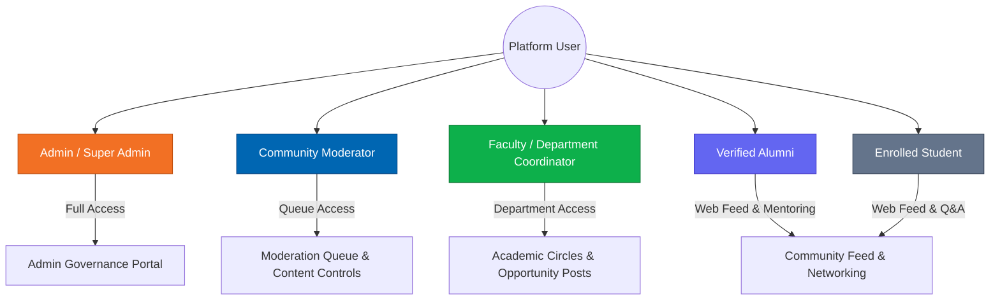
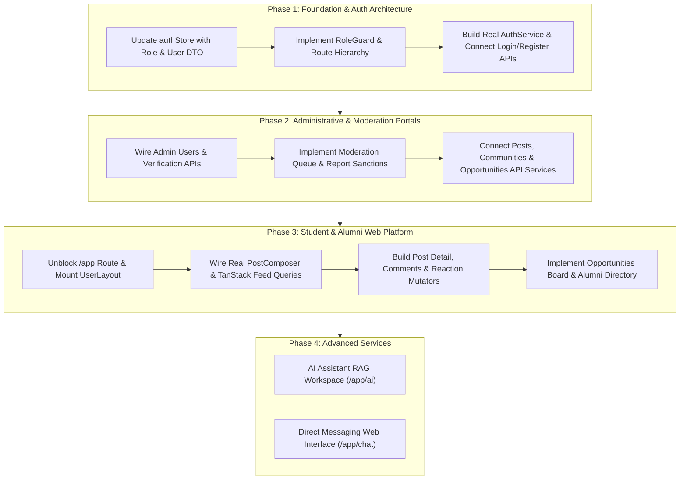

# FPT University Alumni Community Platform
## Comprehensive Role Requirements Matrix & Screen Gap Analysis

**Document Status:** Final Architecture Specification  
**Version:** 1.0.0  
**Target Platform:** Web Application & Responsive Desktop Portal  
**Project Workspace:** `PRN232/ASM`  
**Referenced Baseline Documents:**
- [`docs/user-stories-extracted.txt`](file:///d:/KI%208/PRN232/ASM/docs/user-stories-extracted.txt) (Extracted from [`docs/User Story.xlsx`](file:///d:/KI%208/PRN232/ASM/docs/User%20Story.xlsx))
- [`AGENTS.md`](file:///d:/KI%208/PRN232/ASM/AGENTS.md) (Architectural Guidelines & System Boundaries)
- [`DESIGN.md`](file:///d:/KI%208/PRN232/ASM/DESIGN.md) (FPT Brand Identity, UI Specifications & Color Tokens)
- Current Codebase: [`src/app/router/routes.tsx`](file:///d:/KI%208/PRN232/ASM/src/app/router/routes.tsx), [`src/stores/authStore.ts`](file:///d:/KI%208/PRN232/ASM/src/stores/authStore.ts), [`src/constants/roles.ts`](file:///d:/KI%208/PRN232/ASM/src/constants/roles.ts), [`src/pages/admin/`](file:///d:/KI%208/PRN232/ASM/src/pages/admin/)

---

## 1. Executive Summary & Scope Definition

The **FPT Alumni Community Platform** is a unified digital ecosystem designed to connect over 40,000+ current students, graduated alumni, faculty educators, and administrative governance officers across 5 FPT University campuses (Hoa Lac - Hanoi, Da Nang, Ho Chi Minh City, Can Tho, and Quy Nhon). 

### 1.1 Web Portal vs. Mobile Application Boundary Analysis
A critical finding from auditing the requirements in [`docs/user-stories-extracted.txt`](file:///d:/KI%208/PRN232/ASM/docs/user-stories-extracted.txt) and the codebase routing configuration is the division of labor between Web and Mobile clients:

1. **Mobile Application Scope (Native Convenience & On-the-Go Engagement):**
   - **Direct Push Notifications (`CH-10`):** Explicitly designated for mobile device push services (APNs / FCM) for instant messaging and post interactions.
   - **Micro-interactions:** Rapid feed scrolling, quick likes (`FO-08`), short comment replies (`FO-06`, `FO-07`), camera-based instant photo capture (`FO-03`, `CH-07`), and real-time private chatting (`CH-01` to `CH-06`).
2. **Web Portal Scope (Deep Desktop Workflows, Administration & Academic Operations):**
   - **Administrative & Governance Oversight (`AD-01` to `AD-08`):** Full table management, multi-criteria filtering, user suspension, batch status audits, and system configuration. These are exclusively desktop/web workflows.
   - **Content Moderation & Incident Queues:** High-density review of flagged content, side-by-side post/comment comparisons, sanction actions, and audit logs.
   - **Faculty Academic Operations:** Department community management, capstone/fellowship announcement publishing, student talent lookup, and mentorship schedule coordination.
   - **Desktop Student & Alumni Web Workflows:**
     - High-resolution document upload for **Alumni Degree Verification** (uploading PDF/image transcripts and diplomas), which is cumbersome on mobile.
     - Long-form article and experience composing (Markdown/rich-text editor, multi-paragraph tech insights, interview preparation guides).
     - Opportunity exploration: Browsing detailed job specifications, curriculum vitae (CV) reviews, and corporate recruitment links.
     - Web-based AI Assistant workspace: Exploring full conversational threads with embedded source citations (`AI-01` to `AI-04`).
3. **Current Routing Discrepancy (Architectural Finding):**
   - In [`src/app/router/routes.tsx`](file:///d:/KI%208/PRN232/ASM/src/app/router/routes.tsx#L121-L126), legacy route mapping redirects all `/app/*` paths directly to `/admin/dashboard`. Meanwhile, rich UI structures exist in [`src/layouts/UserLayout.tsx`](file:///d:/KI%208/PRN232/ASM/src/layouts/UserLayout.tsx) and [`src/pages/user/HomePage.tsx`](file:///d:/KI%208/PRN232/ASM/src/pages/user/HomePage.tsx). The web platform must cleanly support both administrative actors and student/alumni web-appropriate workflows through role-aware navigation.

---

## 2. Actor & Role Architecture



### 2.1 Role Definitions & Permission Tiers

| Role / User Type | Code Constant | System Authority Level | Primary Web Focus |
| :--- | :--- | :--- | :--- |
| **System Admin** | `ROLES.ADMIN` | **Level 4 (Global Superuser)** | User lifecycle, alumni verification audits, system policies, global community creation, analytics oversight. |
| **Moderator** | `ROLES.MODERATOR` | **Level 3 (Safety & Content Governance)** | Flagged report queues, post/comment violation enforcement, sanction execution, moderation audit trail. |
| **Faculty / Staff** | `ROLES.USER` + `USER_TYPES.FACULTY` | **Level 2 (Academic Oversight)** | Major-specific community administration, official university announcements, student talent search, mentorship coordination. |
| **Verified Alumni** | `ROLES.USER` + `USER_TYPES.ALUMNI` | **Level 1 (Verified Peer)** | Mentoring, job/internship referral posting, industry experience sharing, alumni verification submission. |
| **Enrolled Student** | `ROLES.USER` + `USER_TYPES.STUDENT` | **Level 1 (Active Learner)** | Q&A asking, feed participation, bookmarking, AI forum assistant, opportunity applications, reporting bad content. |

---

## 3. Detailed Role Requirements Matrix

### 3.1 Administrator (System & Platform Governance)

| User Story ID & Description | Required Screens | Allowed Actions | Restricted Actions | Required Data & State | API Dependencies | Acceptance Criteria |
| :--- | :--- | :--- | :--- | :--- | :--- | :--- |
| **AD-01: User Directory Management**<br>As an Admin, I want to view the list of users to manage accounts across the university. | `/admin/users`<br>([`UsersManagementPage`](file:///d:/KI%208/PRN232/ASM/src/pages/admin/UsersManagementPage.tsx)) | View paginated user list, view account details, view role badges, inspect campus affiliation. | Cannot delete hard database records directly from table without soft-ban confirmation. | Paginated `UserRecord[]`, total count, page size, active filters. | `GET /api/admin/users?page={p}&limit={l}` | **Given** an authenticated Admin on `/admin/users`, **When** the page loads, **Then** all enrolled students, alumni, and faculty accounts are displayed with campus, role, status, and joined dates. |
| **AD-02: User Search & Filter**<br>As an Admin, I want to search users by name or email and filter by campus/role. | `/admin/users` | Type keyword search; filter by Role (`STUDENT`, `ALUMNI`, `FACULTY`, `ADMIN`); filter by Campus (Hoa Lac, HCM, Da Nang, etc.). | Cannot bypass sanitized search query strings. | Filter state (`roleFilter`, `campusFilter`, `searchQuery`), debounced search input. | `GET /api/admin/users?search={q}&role={r}&campus={c}` | **Given** the user directory, **When** the admin enters "hoangdt" or selects "Hoa Lac", **Then** the table immediately filters to matching users within < 300ms. |
| **AD-03: Account Suspension & Lock**<br>As an Admin, I want to lock or unlock violating accounts. | `/admin/users`, User Details Modal | Toggle account status between `active` and `banned`; provide sanction reason; trigger user session revocation. | Cannot suspend other Super Admins without multi-signature approval. | Target `userId`, current `status`, `banReason`, admin token. | `PATCH /api/admin/users/:id/status` `{ status: 'banned', reason: string }` | **Given** an abusive account, **When** Admin clicks "Suspend" and confirms, **Then** account status changes to `banned`, user's active JWT is invalidated, and UI updates with red badge. |
| **AD-04: Global Forum Posts Audit**<br>As an Admin, I want to view all posts on the forum. | `/admin/posts`<br>([`PostsManagementPage`](file:///d:/KI%208/PRN232/ASM/src/pages/admin/PostsManagementPage.tsx)) | View all published posts across all communities; inspect author details, likes, and comment counts. | Cannot edit post content on behalf of the author (only publish/remove). | Paginated `PostRecord[]`, engagement counts, community tags. | `GET /api/admin/posts?page={p}&limit={l}` | **Given** the posts management page, **When** Admin navigates there, **Then** all public and community posts are listed in reverse chronological order. |
| **AD-05: Remove / Hide Violating Posts**<br>As an Admin, I want to delete or hide violating posts. | `/admin/posts`, Post View Drawer | Soft-delete post; toggle visibility to `hidden`/`rejected`; record removal justification. | Cannot permanently destroy audit log history associated with removed post. | Target `postId`, removal reason, moderation status. | `DELETE /api/admin/posts/:id`<br>`PATCH /api/admin/posts/:id/visibility` | **Given** a violating post, **When** Admin clicks "Remove", **Then** post status updates to `rejected`/`hidden`, disappears from public feeds, and is flagged in audit logs. |
| **AD-06: Moderation Reports Queue**<br>As an Admin, I want to view the list of reported posts and comments. | `/admin/reports`<br>([`ReportsManagementPage`](file:///d:/KI%208/PRN232/ASM/src/pages/admin/ReportsManagementPage.tsx)) | View flagged posts, comments, and accounts; inspect reporter rationale, severity (`urgent` vs `pending`), flag counts. | Cannot dismiss reports without viewing the underlying subject details. | `ReportRecord[]`, target content snapshot, reported date, flag tally. | `GET /api/admin/reports?status=pending` | **Given** community-flagged items (`FO-11`), **When** Admin views reports queue, **Then** items with multiple flags or spam scores appear with high-priority badges. |
| **AD-07: Resolve Flagged Reports**<br>As an Admin, I want to process reports by taking down content or dismissing reports. | `/admin/reports` | Click "Sanction" (removes content + warns author); click "Dismiss" (marks report as invalid); add resolution notes. | Cannot undo a sanction without re-opening report case. | `reportId`, resolution action (`approved` / `rejected`), resolution notes. | `POST /api/admin/reports/:id/resolve` `{ action: 'sanction' \| 'dismiss' }` | **Given** a pending report, **When** Admin clicks "Sanction", **Then** the reported post is removed, reporter is thanked via notification, and item moves to resolved tab. |
| **AD-08: System Metrics & Campus Analytics**<br>As an Admin, I want to view statistics of total users, posts, and campus metrics. | `/admin/dashboard`, `/admin/analytics`<br>([`AnalyticsPage`](file:///d:/KI%208/PRN232/ASM/src/pages/admin/AnalyticsPage.tsx)) | View KPI cards (total students, verified alumni, active posts, job vacancies); inspect campus breakdown charts. | Cannot export unmasked personal student PII to external unregulated systems. | KPI aggregation models, campus distribution metrics, historical trends. | `GET /api/admin/analytics/overview`<br>`GET /api/admin/analytics/campus-distribution` | **Given** the Admin Dashboard/Analytics, **When** loaded, **Then** system renders total student/alumni counts, verification rates per campus, and active discussions. |
| **AD-09 / US-VERIFY: Alumni Verification Audit**<br>As an Admin, I want to audit submitted degree certificates and grant verified alumni status. | `/admin/alumni-verification`<br>([`AlumniVerificationPage`](file:///d:/KI%208/PRN232/ASM/src/pages/admin/AlumniVerificationPage.tsx)) | Inspect applicant Student ID, Cohort, Major, and uploaded diploma scan (PDF/PNG); click "Approve" to grant badge or "Reject" with reason. | Cannot grant verification without checking student ID format or attached credential document. | `VerificationRequest[]`, diploma file URL, applicant email, graduation year. | `GET /api/admin/verifications`<br>`POST /api/admin/verifications/:id/approve`<br>`POST /api/admin/verifications/:id/reject` | **Given** a pending verification submission, **When** Admin reviews diploma and clicks "Approve", **Then** user's `isVerified` flag becomes `true`, green badge appears on profile, and user is notified. |
| **AD-10 / SYS-SET: System Configuration & Policies**<br>As an Admin, I want to configure auto-verification rules, moderation sensitivity, and posting permissions. | `/admin/settings`<br>([`SettingsPage`](file:///d:/KI%208/PRN232/ASM/src/pages/admin/SettingsPage.tsx)) | Toggle auto-verification for `@fpt.edu.vn` emails; toggle unverified user job posting access; configure escalation email recipients. | Cannot apply destructive configuration changes without explicit confirmation toast. | System settings state, email domain whitelists, notification threshold values. | `GET /api/admin/settings`<br>`PUT /api/admin/settings` | **Given** the Settings page, **When** Admin updates "Auto-verify institutional emails" and saves, **Then** new applicants with `@fpt.edu.vn` bypass manual document review queue. |
| **AD-11 / COM-ADM: Community Chapter Governance**<br>As an Admin, I want to create and govern academic major circles and regional alumni chapters. | `/admin/communities`<br>([`CommunitiesManagementPage`](file:///d:/KI%208/PRN232/ASM/src/pages/admin/CommunitiesManagementPage.tsx)) | Create new community hubs; assign community leaders; toggle visibility (Public vs Private); archive inactive chapters. | Cannot delete active academic major communities with enrolled members. | `CommunityRecord[]`, category (`ACADEMIC`, `CAMPUS_CHAPTER`, `CAREER`), member counts. | `GET /api/admin/communities`<br>`POST /api/admin/communities`<br>`PATCH /api/admin/communities/:id/status` | **Given** a new regional campus chapter, **When** Admin submits creation form, **Then** community appears in navigation lists for eligible members. |
| **AD-12 / OPP-ADM: Career & Scholarship Governance**<br>As an Admin, I want to oversee job, internship, and scholarship postings. | `/admin/opportunities`<br>([`OpportunitiesManagementPage`](file:///d:/KI%208/PRN232/ASM/src/pages/admin/OpportunitiesManagementPage.tsx)) | Audit external employer postings; approve pending fellowship proposals; filter by job/internship/scholarship; close expired listings. | Cannot approve listings that violate university career guidelines or lack valid contact info. | `OpportunityRecord[]`, company name, deadline, applicant counts, status. | `GET /api/admin/opportunities`<br>`PATCH /api/admin/opportunities/:id/approve` | **Given** a pending scholarship submission, **When** Admin verifies authenticity and approves, **Then** opportunity becomes publicly discoverable in the student board. |

---

### 3.2 Moderator (Content & Community Safety)

| User Story ID & Description | Required Screens | Allowed Actions | Restricted Actions | Required Data & State | API Dependencies | Acceptance Criteria |
| :--- | :--- | :--- | :--- | :--- | :--- | :--- |
| **MOD-01 / AD-06: Inspect Moderation Queue**<br>As a Moderator, I want to inspect user-flagged content to identify community violations quickly. | `/admin/reports`, Content Detail Modal | View pending flagged items filtered by `POST`, `COMMENT`, or `USER_ACCOUNT`; sort by severity. | **Restricted:** Cannot modify system configuration, view user billing data, or access server logs. | Flagged items queue, incident reports, reporter remarks, offending content preview. | `GET /api/moderation/reports?status=pending` | **Given** flagged reports in the system, **When** Moderator logs in, **Then** only moderation-relevant navigation items and reports queue are accessible. |
| **MOD-02 / AD-07 & FO-11: Resolve Violations**<br>As a Moderator, I want to take down offending content or dismiss false-positive reports. | `/admin/reports` | Mark report as `Sanctioned` (triggers post hide); mark report as `Dismissed`; select canned violation policy reason. | **Restricted:** Cannot permanently delete user database records; cannot ban Faculty or Admin accounts. | Incident resolution payload, violation category (Spam, Harassment, Inappropriate Language). | `POST /api/moderation/reports/:id/resolve` | **Given** a reported comment with profanity, **When** Moderator clicks "Sanction", **Then** comment is suppressed, a strike is logged against the user, and report is resolved. |
| **MOD-03 / AD-05: Direct Content Suppression**<br>As a Moderator, I want to hide spam or toxic posts directly from the forum feed or posts table. | `/admin/posts`, Feed Post Card Context Menu | Click "Hide Content" from moderation menu; enter moderation justification; shadow-ban spam links. | **Restricted:** Cannot edit the text authored by another user. | `postId`, moderator action type, reason string. | `PATCH /api/moderation/posts/:id/hide` | **Given** spam content in a community feed, **When** Moderator hides the post, **Then** it immediately disappears from non-moderator views. |
| **MOD-04: Moderation History & Audit Trail**<br>As a Moderator, I want to review past moderation actions to ensure consistent policy enforcement. | `/admin/reports?tab=history` | View history of resolved reports; see which moderator handled the case and timestamp of resolution. | **Restricted:** Cannot delete or tamper with moderation audit logs. | Historical audit log entries, moderator ID, action taken, timestamp. | `GET /api/moderation/history` | **Given** past resolved cases, **When** Moderator navigates to history, **Then** full chronological audit records are rendered with read-only badges. |
| **MOD-05: Issuing User Policy Warnings**<br>As a Moderator, I want to send formal policy violation notices to users before account suspension. | User Sanction Dialog on `/admin/reports` | Send structured policy warning notification to offending user; record strike count (1st/2nd/3rd warning). | **Restricted:** Cannot issue warnings without referencing an active report or post ID. | `userId`, strike level, violation template, warning message. | `POST /api/moderation/users/:id/warn` | **Given** a first-time offending user, **When** Moderator issues a warning, **Then** user receives an in-app security alert explaining the guideline violation. |

---

### 3.3 Faculty / Staff (Academic & Department Coordination)

| User Story ID & Description | Required Screens | Allowed Actions | Restricted Actions | Required Data & State | API Dependencies | Acceptance Criteria |
| :--- | :--- | :--- | :--- | :--- | :--- | :--- |
| **FAC-01: Major Community Oversight**<br>As a Faculty Coordinator, I want to oversee my department's academic community to guide student discussions. | `/app/communities/:communityId`, `/admin/communities` | Pin official academic announcements; pin capstone guidelines; moderate department discussions. | **Restricted:** Cannot modify academic communities outside assigned department without permission. | Community metadata, member directory, pinned post list. | `GET /api/communities/:id`<br>`POST /api/communities/:id/pin` | **Given** a Faculty Coordinator of Software Engineering, **When** viewing the SE community, **Then** pinned announcements appear at the top with official department badges. |
| **FAC-02: Publish Academic Opportunities**<br>As Faculty, I want to post capstone proposals, research assistantships, and scholarships. | `/admin/opportunities`, `/app/posts/create` | Publish verified department opportunities; mark as `INTERNSHIP`, `SCHOLARSHIP`, or `RESEARCH`; set deadlines. | **Restricted:** Cannot charge fees or post unverified third-party commercial advertisements. | Opportunity DTO (title, criteria, stipend/grant, deadline, contact email). | `POST /api/opportunities`<br>`GET /api/opportunities/department` | **Given** an upcoming OJT semester, **When** Faculty publishes research lab vacancies, **Then** post is tagged with "Verified Academic Opportunity" and listed in Jobs/Internships boards. |
| **FAC-03 / US-05, US-06: Student & Alumni Directory Lookup**<br>As Faculty, I want to look up students and alumni by major and cohort for capstone evaluation and advising. | `/app/alumni`, `/admin/users` | Search directory by Student ID, Major, Cohort (e.g. K15), and current industry employer; view academic profiles. | **Restricted:** Cannot view private personal contact info if user configured privacy hidden (`US-09`). | Directory search index, user profile summaries, graduation records. | `GET /api/users/directory?major={m}&cohort={c}` | **Given** capstone team pairing, **When** Faculty searches "K16 AI", **Then** matching students and alumni mentors in AI are displayed with verified credentials. |
| **FAC-04: Department Mentorship Coordination**<br>As Faculty, I want to coordinate office hours and mentorship workshops connecting alumni with students. | `/app/communities/:id`, Event Post Modal | Schedule online office hours; attach mentorship cards to posts ([`attachedCard.type = 'MENTORSHIP'`](file:///d:/KI%208/PRN232/ASM/src/features/posts/components/PostCard.tsx#L42)); track student attendee counts. | **Restricted:** Cannot modify alumni personal availability slots directly. | Mentorship event session, calendar time, max slots, RSVP count. | `POST /api/mentorship/sessions`<br>`GET /api/mentorship/sessions/:id/rsvps` | **Given** an alumni whiteboard session, **When** Faculty schedules office hours, **Then** session renders an RSVP action card on the community feed (`PostCard`). |

---

### 3.4 Enrolled Student (Learner Workflows on Web)

| User Story ID & Description | Required Screens | Allowed Actions | Restricted Actions | Required Data & State | API Dependencies | Acceptance Criteria |
| :--- | :--- | :--- | :--- | :--- | :--- | :--- |
| **US-01 & US-02: Student Login**<br>As a student, I want to sign in with email/password or Google SSO. | `/auth/login`<br>([`LoginForm`](file:///d:/KI%208/PRN232/ASM/src/features/auth/components/LoginForm.tsx)) | Enter university email & password; click Google Workspace SSO button; remember device. | Cannot access administrative `/admin/*` routes. | User session, auth token, role: `USER`, userType: `STUDENT`. | `POST /api/auth/login`<br>`POST /api/auth/google` | **Given** valid student credentials, **When** submitted, **Then** user receives JWT token and is directed to the Community Feed (`/app/home`). |
| **US-04 & US-09: Student Profile & Privacy**<br>As a student, I want to update my profile and customize what info is public. | `/app/profile`, `/app/settings` | Update avatar, bio, campus, major, cohort; toggle privacy for GPA, phone, or email. | Cannot change verified Student ID or institutional email without registrar contact. | `UserProfile` DTO, privacy settings map (`showEmail`, `showCohort`). | `GET /api/users/me`<br>`PUT /api/users/me` | **Given** profile editor, **When** student updates bio and clicks Save, **Then** profile card reflects changes immediately across communities. |
| **FO-01 to FO-03: Create Discussion / Q&A Post**<br>As a student, I want to post academic questions and attach images. | `/app/home`, `/app/posts/create`<br>([`PostComposer`](file:///d:/KI%208/PRN232/ASM/src/features/posts/components/PostComposer.tsx)) | Type markdown/text content; tag post type (`QUESTION`, `EXPERIENCE`); attach screenshots/images; pick target community. | Cannot post in private alumni-only chapters; cannot post empty content. | Composer state (`content`, `selectedType`, `images[]`, `communityId`). | `POST /api/posts` | **Given** a technical question, **When** student submits with `QUESTION` chip, **Then** post appears on the feed with "Hỏi đáp cộng đồng" badge. |
| **FO-04 & FO-10: Manage Own Posts**<br>As a student, I want to edit/delete my posts and see all posts I created. | `/app/home`, `/app/profile?tab=posts` | Edit content of authored posts; delete authored post; view personal post history. | Cannot delete or edit posts created by other users. | Post ownership ID (`authorId === currentUserId`), post history list. | `PUT /api/posts/:id`<br>`DELETE /api/posts/:id`<br>`GET /api/users/me/posts` | **Given** an authored post, **When** student clicks "Delete" on post menu, **Then** post is removed from feed after confirmation. |
| **FO-06 to FO-08: Comments, Replies & Likes**<br>As a student, I want to comment, reply, and like posts to engage. | Feed Post Card ([`PostCard`](file:///d:/KI%208/PRN232/ASM/src/features/posts/components/PostCard.tsx)) | Click Like/Unlike (optimistic toggle); submit comment; reply to existing comment threads. | Cannot spam duplicate likes; cannot comment on locked threads. | Like count, `isLiked` boolean, comment thread array. | `POST /api/posts/:id/like`<br>`DELETE /api/posts/:id/like`<br>`POST /api/posts/:id/comments` | **Given** a post on feed, **When** student clicks heart icon, **Then** heart turns red, like count increments by 1 without full page reload. |
| **FO-09: Bookmark / Save Posts**<br>As a student, I want to save posts to read later. | Feed Post Card, `/app/saved` | Click Bookmark icon on post; view saved collection on `/app/saved`. | Cannot view saved posts of another student (private list). | `savedPostIds[]`, saved posts list. | `POST /api/posts/:id/save`<br>`GET /api/posts/saved` | **Given** an informative post, **When** student clicks bookmark, **Then** post is stored in Saved items accessible from left sidebar. |
| **FO-11: Report Offensive Content**<br>As a student, I want to report posts or comments that violate guidelines. | Post / Comment Context Menu Modal | Select report reason (Spam, Harassment, Inappropriate, Scam); submit report to queue. | Cannot file repeated duplicate reports on the same post. | Target `postId`/`commentId`, selected reason, description text. | `POST /api/reports` | **Given** an offensive post, **When** student reports it, **Then** item enters Moderator queue (`AD-06`) and confirmation message displays. |
| **FO-12 to FO-16: Campus Filter & Q&A Solver Filter**<br>As a student, I want to filter by campus, search keywords, and find unanswered questions. | Topbar ([`CampusDropdown`](file:///d:/KI%208/PRN232/ASM/src/components/layout/Navbar.tsx#L24)), [`PostFeedFilters`](file:///d:/KI%208/PRN232/ASM/src/features/posts/components/PostFeedFilters.tsx) | Filter feed by Campus (Hoa Lac, HCM, etc.); filter by category chips; filter by "Unanswered Questions". | Cannot view content of campuses restricted by chapter privacy. | Active campus, selected filter (`QUESTIONS`, `EXPERIENCES`, `UNANSWERED`), query. | `GET /api/posts?campus={c}&category={cat}&unanswered=true` | **Given** student looking to help peers, **When** selecting "Unanswered", **Then** only questions with 0 answers appear. |
| **AI-01 to AI-04: AI Academic & Forum Assistant**<br>As a student, I want to ask AI questions and receive answers cited from FPT forum posts. | `/app/ai`, AI Widget | Ask question in chat input; receive generated answer synthesized from forum posts; inspect source post links; follow up. | Cannot generate answers containing confidential student grades or leaked exams. | Conversational history `AiMessage[]`, retrieved forum reference chunks. | `POST /api/ai/chat` `{ prompt: string, conversationId: string }` | **Given** a query about "OJT tips in Da Nang", **When** student asks AI, **Then** AI provides synthesized response with clickable citations to real alumni posts. |
| **CH-01 to CH-09: Desktop Direct Messaging**<br>As a student, I want to chat with alumni mentors and fellow students on web. | `/app/chat`, Messages Dropdown | Start conversation; send text and images; view conversation history; view read receipts; mute conversation. | Cannot message users who have blocked the student (`US-10`). | `ChatConversation[]`, message history, typing status indicators. | `GET /api/chat/conversations`<br>`POST /api/chat/messages`<br>`WebSocket /ws/chat` | **Given** desktop chat view, **When** student types and presses enter, **Then** message renders immediately via WebSocket and recipient sees typing indicator. |

---

### 3.5 Verified Alumni (Graduate Workflows on Web)

| User Story ID & Description | Required Screens | Allowed Actions | Restricted Actions | Required Data & State | API Dependencies | Acceptance Criteria |
| :--- | :--- | :--- | :--- | :--- | :--- | :--- |
| **US-VERIFY-REQ: Submit Alumni Verification**<br>As an alumni, I want to submit my degree certificate to receive the Verified Alumni badge. | `/auth/register` (Step 3/4), `/app/settings/verification` | Upload diploma/transcript file (`.pdf`, `.png`, `.jpg`); input Student ID, Cohort, Graduation Year; track status. | Cannot upload files > 10MB or unapproved MIME types; cannot re-submit while status is `pending`. | Verification request payload, uploaded file binary, graduation metadata. | `POST /api/alumni/verification-requests` (multipart form-data) | **Given** an unverified alumni, **When** uploading a graduation certificate scan, **Then** submission enters Admin Verification Queue (`AD-09`). |
| **OPP-01 to OPP-03: Post Job & Internship Referrals**<br>As a verified alumni, I want to post job opportunities and internal employee referrals for students. | `/app/jobs/create`, `/app/posts/create` | Post job listing with company, role, OJT level, and deadline; toggle "Internal Referral Available"; review applicants. | **Restricted:** Unverified alumni cannot post jobs without moderator pre-approval (governed by `SettingsPage`). | `Opportunity` DTO, company logo, referral slots, target majors. | `POST /api/opportunities`<br>`GET /api/opportunities/my-posts` | **Given** a verified alumni at Google or Stripe, **When** posting an internship referral, **Then** post renders with green "Verified Referral" badge (`PostCard`). |
| **ALUM-MENTOR: Offer Mentorship Office Hours**<br>As a verified alumni, I want to indicate I am accepting mentees and offer virtual office hours. | `/app/profile`, `/app/alumni` | Toggle "Accepting Mentees" badge; configure available topics (System Design, Resume Review); set appointment link. | Cannot charge students unapproved fees for mentorship on university platform. | Profile mentor toggle (`isAcceptingMentees: boolean`), expertise tags, booking URL. | `PATCH /api/alumni/profile/mentorship` | **Given** alumni profile, **When** "Accepting Mentees" is enabled, **Then** alumni card on [`RightSidebar`](file:///d:/KI%208/PRN232/ASM/src/components/layout/RightSidebar.tsx#L121) shows pulsing green status indicator. |
| **US-10: Block / Unblock Accounts**<br>As a user/alumni, I want to block abusive accounts to stop unwanted interactions. | User Profile Page, Chat Header Menu | Click "Block User"; confirm blocking; unblock from privacy settings. | Cannot block System Administrators or official University notification bots. | Blocked user ID list in user settings. | `POST /api/users/:id/block`<br>`DELETE /api/users/:id/block` | **Given** an annoying user, **When** blocked, **Then** blocked user cannot send direct messages or comment on alumni's posts. |

---

## 4. Screen Inventory & Gap Report

This audit compares the requirements matrix against every screen, component, and route in the current codebase.

### 4.1 Master Screen Inventory

| Screen / Feature | Route Path | Target Actor(s) | Current Implementation Status | Existing Artifacts in Codebase | Identified Functional Gaps | Implementation Priority |
| :--- | :--- | :--- | :--- | :--- | :--- | :--- |
| **Admin Dashboard** | `/admin/dashboard` | Admin | **Implemented (Mock)** | [`DashboardPage.tsx`](file:///d:/KI%208/PRN232/ASM/src/pages/admin/DashboardPage.tsx), [`StatCard.tsx`](file:///d:/KI%208/PRN232/ASM/src/components/admin/StatCard.tsx), [`DataTable.tsx`](file:///d:/KI%208/PRN232/ASM/src/components/admin/DataTable.tsx) | Uses component-level mock state; lacks TanStack Query hooks; needs live API metrics synchronization. | **P0** (Connect API) |
| **User Directory** | `/admin/users` | Admin, Faculty (view) | **Implemented (Mock)** | [`UsersManagementPage.tsx`](file:///d:/KI%208/PRN232/ASM/src/pages/admin/UsersManagementPage.tsx), [`Avatar.tsx`](file:///d:/KI%208/PRN232/ASM/src/components/ui/avatar.tsx) | Suspend button only updates local state; no real confirmation dialog modal; missing detail drawer. | **P0** |
| **Alumni Verification Audit** | `/admin/alumni-verification` | Admin | **Implemented (Mock)** | [`AlumniVerificationPage.tsx`](file:///d:/KI%208/PRN232/ASM/src/pages/admin/AlumniVerificationPage.tsx) | Document preview button has no modal view for PDF/images; approve/reject actions are mock only. | **P0** |
| **Post Management** | `/admin/posts` | Admin, Moderator | **Implemented (Mock)** | [`PostsManagementPage.tsx`](file:///d:/KI%208/PRN232/ASM/src/pages/admin/PostsManagementPage.tsx) | Delete action only filters local array; missing post content preview drawer; no batch actions. | **P1** |
| **Moderation & Reports Queue** | `/admin/reports` | Admin, Moderator | **Implemented (Mock)** | [`ReportsManagementPage.tsx`](file:///d:/KI%208/PRN232/ASM/src/pages/admin/ReportsManagementPage.tsx) | Inspect button lacks detail modal; sanction action does not prompt for reason; no audit history tab. | **P0** |
| **Community Chapter Management** | `/admin/communities` | Admin, Faculty | **Implemented (Mock)** | [`CommunitiesManagementPage.tsx`](file:///d:/KI%208/PRN232/ASM/src/pages/admin/CommunitiesManagementPage.tsx) | "Create Community" modal not wired; archive only toggles mock state. | **P1** |
| **Opportunities Management** | `/admin/opportunities` | Admin, Faculty | **Implemented (Mock)** | [`OpportunitiesManagementPage.tsx`](file:///d:/KI%208/PRN232/ASM/src/pages/admin/OpportunitiesManagementPage.tsx) | "Post Opportunity" button not hooked to modal/form; lacks application resume viewer. | **P1** |
| **System Settings** | `/admin/settings` | Admin | **Implemented (Mock)** | [`SettingsPage.tsx`](file:///d:/KI%208/PRN232/ASM/src/pages/admin/SettingsPage.tsx) | Settings do not persist to backend database; missing role permission matrix settings. | **P1** |
| **Analytics & Growth Reports** | `/admin/analytics` | Admin | **Implemented (Static)** | [`AnalyticsPage.tsx`](file:///d:/KI%208/PRN232/ASM/src/pages/admin/AnalyticsPage.tsx) | Hardcoded static numbers; missing date range pickers and export to CSV/PDF. | **P2** |
| **Login Page** | `/auth/login` | All Actors | **Implemented (Mock)** | [`LoginPage.tsx`](file:///d:/KI%208/PRN232/ASM/src/pages/auth/LoginPage.tsx), [`LoginForm.tsx`](file:///d:/KI%208/PRN232/ASM/src/features/auth/components/LoginForm.tsx) | Sets fake token in localStorage; does not query backend API; does not retrieve role/user profile. | **P0** |
| **Multi-Step Register** | `/auth/register` | Student, Alumni | **Implemented (Mock)** | [`RegisterPage.tsx`](file:///d:/KI%208/PRN232/ASM/src/pages/auth/RegisterPage.tsx), [`RegisterForm.tsx`](file:///d:/KI%208/PRN232/ASM/src/features/auth/components/RegisterForm.tsx) | Successful submission sets mock token but does not post to backend; lacks document upload field. | **P0** |
| **Verify Email Page** | `/auth/verify-email` | Student, Alumni | **Missing / Placeholder** | Route exists in [`routes.tsx`](file:///d:/KI%208/PRN232/ASM/src/app/router/routes.tsx#L51) mapped to `<Outlet />` | No page component, no token confirmation input, no resend email countdown. | **P1** |
| **Forgot Password Page** | `/auth/forgot-password` | All Actors | **Missing / Placeholder** | Route exists in [`routes.tsx`](file:///d:/KI%208/PRN232/ASM/src/app/router/routes.tsx#L55) mapped to `<Outlet />` | No password reset request form or reset token verification form. | **P1** |
| **Community Feed (Home)** | `/app/home` | Student, Alumni, Faculty | **Partially Implemented (Blocked by redirect)** | [`HomePage.tsx`](file:///d:/KI%208/PRN232/ASM/src/pages/user/HomePage.tsx), [`UserLayout.tsx`](file:///d:/KI%208/PRN232/ASM/src/layouts/UserLayout.tsx), [`PostCard.tsx`](file:///d:/KI%208/PRN232/ASM/src/features/posts/components/PostCard.tsx) | [`routes.tsx`](file:///d:/KI%208/PRN232/ASM/src/app/router/routes.tsx#L125) redirects `/app/*` to `/admin/dashboard`; PostComposer doesn't save to backend; comment section is closed/non-interactive. | **P0** |
| **Communities Hub** | `/app/communities` | Student, Alumni, Faculty | **Missing** | Route defined in [`ROUTES.APP`](file:///d:/KI%208/PRN232/ASM/src/constants/routes.ts#L23); `.gitkeep` in folder | No page component; cannot browse or join communities. | **P1** |
| **Community Detail** | `/app/communities/:id` | Student, Alumni, Faculty | **Missing** | Route defined in [`ROUTES.APP`](file:///d:/KI%208/PRN232/ASM/src/constants/routes.ts#L24) | No page component; cannot view specific major feeds or pinned guidelines. | **P1** |
| **Post Detail & Comments** | `/app/posts/:postId` | All Users | **Missing** | Route defined in [`ROUTES.APP`](file:///d:/KI%208/PRN232/ASM/src/constants/routes.ts#L26) | Cannot expand full nested comment tree or view dedicated post URL. | **P0** |
| **Alumni Directory** | `/app/alumni` | Student, Alumni, Faculty | **Missing** | Route defined in [`ROUTES.APP`](file:///d:/KI%208/PRN232/ASM/src/constants/routes.ts#L27) | No directory listing page with major/cohort filters. | **P1** |
| **User / Alumni Profile** | `/app/alumni/:userId`, `/app/profile` | All Users | **Missing** | Route defined in [`ROUTES.APP`](file:///d:/KI%208/PRN232/ASM/src/constants/routes.ts#L28,L39) | No profile page with bio, graduation stats, authored posts, or privacy toggles. | **P1** |
| **Opportunities / Jobs Board**| `/app/jobs`, `/app/internships`, `/app/scholarships` | Student, Alumni, Faculty | **Missing** | Routes defined in [`ROUTES.APP`](file:///d:/KI%208/PRN232/ASM/src/constants/routes.ts#L29-L33) | No public listings page for students to browse jobs, internships, or scholarships. | **P1** |
| **AI Assistant Chat** | `/app/ai` | Student, Alumni | **Missing** | Route defined in [`ROUTES.APP`](file:///d:/KI%208/PRN232/ASM/src/constants/routes.ts#L37); types in [`ai.types.ts`](file:///d:/KI%208/PRN232/ASM/src/types/ai.types.ts) | No conversational UI, prompt bar, or citation reference renderer. | **P2** |
| **Chat & Direct Messaging** | `/app/chat` | All Users | **Missing** | Route defined in [`ROUTES.APP`](file:///d:/KI%208/PRN232/ASM/src/constants/routes.ts#L35); types in [`chat.types.ts`](file:///d:/KI%208/PRN232/ASM/src/types/chat.types.ts) | No conversation list, chat bubbles, or WebSocket connectivity. | **P2** |
| **Notifications Page** | `/app/notifications` | All Users | **Missing** | Route defined in [`ROUTES.APP`](file:///d:/KI%208/PRN232/ASM/src/constants/routes.ts#L36) | Only popover bell icon placeholder in navbar; no notifications center. | **P2** |
| **Saved Posts** | `/app/saved` | Student, Alumni | **Missing** | Route defined in [`ROUTES.APP`](file:///d:/KI%208/PRN232/ASM/src/constants/routes.ts#L38) | Bookmarking toggle works in local card state, but saved posts page is missing. | **P2** |

---

### 4.2 Architectural & Foundation Gaps

#### 1. Routing & Guarding Gap (Critical P0)
- **Problem:** Currently, [`src/app/router/guards.tsx`](file:///d:/KI%208/PRN232/ASM/src/app/router/guards.tsx#L10-L18) only checks boolean `isAuthenticated`. It does **not** inspect user roles (`ROLES.ADMIN`, `ROLES.MODERATOR`, `ROLES.USER`).
- **Consequence:** A regular student or moderator who signs in is either granted access to all admin screens or redirected away without role-based route separation.
- **Remediation:** Introduce a `RoleGuard` component taking allowed roles (e.g. `<RoleGuard allowedRoles={[ROLES.ADMIN, ROLES.MODERATOR]} />`).

#### 2. Auth State Management Gap (Critical P0)
- **Problem:** [`src/stores/authStore.ts`](file:///d:/KI%208/PRN232/ASM/src/stores/authStore.ts#L4-L9) only persists `{ token, isAuthenticated }`. It lacks `user` details:
  ```ts
  // Current:
  export interface AuthState {
    token: string | null
    isAuthenticated: boolean
    setToken: (token: string | null) => void
    clearAuth: () => void
  }
  ```
- **Remediation:** Extend `AuthState` to store `currentUser: UserSummary | null`, `role: Role | null`, and `userType: UserType | null`.

#### 3. API & Service Integration Gap (Critical P0)
- **Problem:** All domain services in `src/services/*/index.ts` (e.g. [`src/services/posts/index.ts`](file:///d:/KI%208/PRN232/ASM/src/services/posts/index.ts#L5), [`src/services/auth/index.ts`](file:///d:/KI%208/PRN232/ASM/src/services/auth/index.ts#L5), [`src/services/users/index.ts`](file:///d:/KI%208/PRN232/ASM/src/services/users/index.ts)) export empty objects `{}`.
- **Consequence:** UI pages in `src/pages/admin/` and `src/features/` rely on mock data directly written in component bodies, violating the architecture rule in [`AGENTS.md`](file:///d:/KI%208/PRN232/ASM/AGENTS.md#L34-L39) (*"Never make raw fetch or inline data fetching; consume bounded services via TanStack Query"*).
- **Remediation:** Implement bounded API methods using `apiClient` and create TanStack Query hooks in `src/features/*/hooks/`.

#### 4. End-User Route Redirection Gap (High P1)
- **Problem:** [`src/app/router/routes.tsx`](file:///d:/KI%208/PRN232/ASM/src/app/router/routes.tsx#L124-L126) actively redirects `/app/*` to `/admin/dashboard`.
- **Consequence:** Even though [`UserLayout.tsx`](file:///d:/KI%208/PRN232/ASM/src/layouts/UserLayout.tsx) and [`HomePage.tsx`](file:///d:/KI%208/PRN232/ASM/src/pages/user/HomePage.tsx) exist and are styled with FPT branding, users cannot access the community feed, post composer, or sidebar widgets on desktop.
- **Remediation:** Mount `UserLayout` under `/app` route with `HomePage` as index child.

---

## 5. Technical Implementation Roadmap



### 5.1 Immediate Recommendations for Development Agent
1. **Security & Role Context:**
   - Update `authStore.ts` to decode JWT token payload and store user identity, role (`ADMIN`, `MODERATOR`, `USER`), and type (`STUDENT`, `ALUMNI`, `FACULTY`).
   - Split navigation in [`AdminSidebar.tsx`](file:///d:/KI%208/PRN232/ASM/src/components/layout/AdminSidebar.tsx#L38-L86) based on role (Moderators only see Content, Communities, and Reports; Admins see Overview, Users, Verification, Analytics, and Settings).
2. **Resolve Missing Modals:**
   - Add a Document Inspection Modal in [`AlumniVerificationPage.tsx`](file:///d:/KI%208/PRN232/ASM/src/pages/admin/AlumniVerificationPage.tsx#L140) to render diploma PDFs or scans.
   - Add a Sanction Reason Modal in [`ReportsManagementPage.tsx`](file:///d:/KI%208/PRN232/ASM/src/pages/admin/ReportsManagementPage.tsx#L136) to prevent accidental content takedowns.
3. **Restore Web Social Experience:**
   - Re-enable `/app/home` with `UserLayout` so that student and faculty web workflows function seamlessly alongside administrative capabilities.
